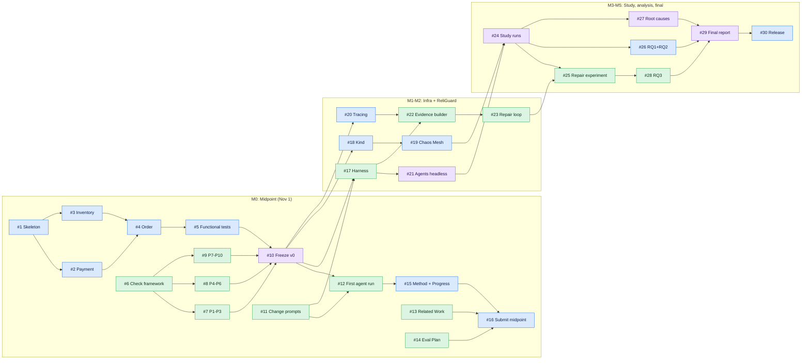

# ReliGuard

**It Worked Yesterday: Detecting and Repairing Reliability Regressions in Microservices Maintained by AI Coding Agents**

CS 59300-ASE, Fall 2026, Purdue University. Vedant Prabhu and Yash Tembhurnikar.

AI coding agents are now asked to keep changing existing systems, and each change is usually checked only with functional tests. Those tests do not tell us whether a change quietly broke how the system behaves when something fails: a slow dependency, a crashed service, a lost response. We call that a **reliability regression**: a property about behavior under failure (bounded latency, safe retries, no duplicate side effects, recovery after an outage) that held before a change and no longer holds after it.

The project has two parts:

1. **Study.** Drive three coding agents (Claude Code, Codex CLI, GitHub Copilot's coding agent) through the same 8 changes to a checkout microservice app, 3 runs each (72 versions), and measure how often, where, and why reliability regressions appear.
2. **Tool: ReliGuard.** After every agent change, inject faults, re-check *every* reliability property, give the agent structured evidence when one fails, and accept a repair only if the whole property suite passes again.

The proposal and the course's midpoint instructions are kept out of this repo (shared between the authors directly).

---

## Tracking the work

All work is tracked as [GitHub Issues](https://github.com/Yash-11-star/religuard/issues). Every ticket has:

- A **title prefix** and an **owner label** showing who does it:

  | Label | Filter |
  |---|---|
  | `owner: Yash` | [Yash's tickets](https://github.com/Yash-11-star/religuard/issues?q=is%3Aissue+is%3Aopen+label%3A%22owner%3A+Yash%22) |
  | `owner: Vedant` | [Vedant's tickets](https://github.com/Yash-11-star/religuard/issues?q=is%3Aissue+is%3Aopen+label%3A%22owner%3A+Vedant%22) |
  | `owner: Both` | [Shared tickets](https://github.com/Yash-11-star/religuard/issues?q=is%3Aissue+is%3Aopen+label%3A%22owner%3A+Both%22) |

- An **area label** (`area: services`, `area: infra`, `area: properties`, `area: harness`, `area: religuard`, `area: study`, `area: report`).
- A **milestone** for the week it belongs to. See [Milestones](https://github.com/Yash-11-star/religuard/milestones).
- A description with **Goal, Context, Tasks (checklist), Done when, Depends on, Estimate**.

How to work a ticket: tick the checklist boxes in the issue as you go, open a PR that says `Closes #N`, and the ticket closes when the PR merges.

---

## Order of work

**Rule:** always pick the next open ticket in your own queue below. If it is blocked, skip to the next unblocked one and come back.

Each ticket also shows this at the top (its phase, your step number, what it waits on, what it unblocks), and GitHub marks a ticket **Blocked** until the tickets it depends on are closed.

### Start right now (nothing blocks these)

| Yash | Vedant |
|---|---|
| [#1](https://github.com/Yash-11-star/religuard/issues/1) Repo skeleton + docker-compose | [#6](https://github.com/Yash-11-star/religuard/issues/6) Property-check framework |
| | [#11](https://github.com/Yash-11-star/religuard/issues/11) 8 change prompts |
| | [#13](https://github.com/Yash-11-star/religuard/issues/13) Related Work, [#14](https://github.com/Yash-11-star/religuard/issues/14) Evaluation Plan |

### Each person's queue

| Step | Yash | Vedant |
|---|---|---|
| 1 | #1 Repo skeleton + compose | #6 Property-check framework |
| 2 | #2 Payment service | #7 Checks P1–P3 |
| 3 | #3 Inventory service | #8 Checks P4–P6 |
| 4 | #4 Order service | #9 Checks P7–P10 |
| 5 | #5 Functional tests | #11 8 change prompts |
| 6 | **#10 Freeze Version 0** (together) | #13 Report: Related Work |
| 7 | #15 Report: Intro + Method/Progress | #14 Report: Evaluation Plan |
| 8 | #16 Report: assemble + **submit** | **#10 Freeze Version 0** (together) |
| 9 | #18 Move to Kind | #12 First agent run |
| 10 | #20 Tracing + logs | #17 Agent harness |
| 11 | #19 Chaos Mesh | #21 Agents headless (Copilot part) |
| 12 | #21 Agents headless (Claude + Codex part) | #22 Evidence builder |
| 13 | #24 Study runs (Claude + Codex) | #23 Repair loop |
| 14 | #26 Analysis RQ1 + RQ2 | #24 Study runs (Copilot) |
| 15 | #27 Root-cause labels (together) | #25 Repair experiment |
| 16 | #29 Final report (together) | #27 Root-cause labels (together) |
| 17 | #30 Public release | #28 Analysis RQ3 |
| 18 | | #29 Final report (together) |

Steps 1–8 are the midpoint (M0). Vedant writes the property checks (#7–#9) and the report sections (#13, #14) against the endpoints described in #2–#4, so they don't have to wait for Yash's services. The checks get their first real run at #10.

### Dependency graph

An arrow `A --> B` means B cannot start until A is done. Blue = Yash, green = Vedant, purple = both.



**Critical path** (the longest chain; a delay on any of these delays the whole project):
#1 → #2/#3 → #4 → #5 → #10 → #17 → #22 → #23 → #25 → #28 → #29 → #30.
For the midpoint, the critical path is Yash's services (#1–#5). If they slip, cut #12 to a single change and submit with the checks and the plan.

---

## Midpoint plan (due Nov 1, 11:59 PM)

### Step 1: Set up a smaller Version 0 (Yash)

- Write Order, Payment, and Inventory as small **Python FastAPI** services with **Postgres**, run with **docker-compose**. Leave Kind/Kubernetes for later.
- Put **Toxiproxy** between Order→Payment and Order→Inventory (and Order→Postgres). It covers latency, outages, and dropped responses. Chaos Mesh needs Kubernetes, so it comes later.
- Payment has a `charges` table and a `/admin/charges` endpoint so checks can count duplicate charges, plus a fault switch for HTTP 503s (Toxiproxy cannot produce those).
- Build in the reliability features the properties check: timeouts, bounded retries with backoff, idempotency keys, and releasing inventory when payment fails.

### Step 2: Write the reliability property checks (Vedant, in parallel)

Use pytest. Each test sets up a fault, sends a checkout, and asserts the expected behavior:

| # | Fault | Expected property |
|---|---|---|
| P1 | Payment +5 s latency | Checkout returns an error in ≤ 3 s |
| P2 | Inventory +5 s latency | Checkout returns an error in ≤ 3 s |
| P3 | Payment down | Clean 503 with a clear error body, no hang |
| P4 | Payment 503 burst | Payment receives ≤ 3 attempts (bounded retries) |
| P5 | Response dropped after charge | Retried checkout charges once |
| P6 | Duplicate request delivery | Single charge (idempotency) |
| P7 | Payment outage, then restore | Checkouts succeed within 10 s |
| P8 | Payment fails | Inventory reservation is released |
| P9 | Any fault | No orders stuck in `PENDING` |
| P10 | DB latency | Bounded latency, graceful error |

Version 0 must pass all of them, plus the functional tests.

### Step 3: First agent run (Vedant)

Run Claude Code on change #1 (Notification service) and #2 (retries on payment calls), then run the functional tests and P1–P10 after each change.

### Step 4: Write the report (both)

ACM double-column template, ≤ 8 pages: updated Abstract/Intro, Related Work, Method and Progress, Evaluation Plan.

---

## All tickets

### M0: Midpoint report (Nov 1)

| # | Ticket | Owner |
|---|---|---|
| [#1](https://github.com/Yash-11-star/religuard/issues/1) | Repo skeleton + docker-compose with Postgres and Toxiproxy | Yash |
| [#2](https://github.com/Yash-11-star/religuard/issues/2) | Payment service: charges table, idempotency keys, admin + fault endpoints | Yash |
| [#3](https://github.com/Yash-11-star/religuard/issues/3) | Inventory service: reserve / release / commit | Yash |
| [#4](https://github.com/Yash-11-star/religuard/issues/4) | Order service with reliability features | Yash |
| [#5](https://github.com/Yash-11-star/religuard/issues/5) | Functional test suite for Version 0 | Yash |
| [#6](https://github.com/Yash-11-star/religuard/issues/6) | Property-check framework: pytest fixtures and helpers | Vedant |
| [#7](https://github.com/Yash-11-star/religuard/issues/7) | Property checks P1–P3: bounded latency and graceful errors | Vedant |
| [#8](https://github.com/Yash-11-star/religuard/issues/8) | Property checks P4–P6: bounded retries and idempotency | Vedant |
| [#9](https://github.com/Yash-11-star/religuard/issues/9) | Property checks P7–P10: recovery, consistency, stuck orders, DB latency | Vedant |
| [#10](https://github.com/Yash-11-star/religuard/issues/10) | Freeze Version 0: all green, tag `v0` | Both |
| [#11](https://github.com/Yash-11-star/religuard/issues/11) | Write the 8 change-request prompts | Vedant |
| [#12](https://github.com/Yash-11-star/religuard/issues/12) | First agent run: Claude Code on changes #1 and #2 | Vedant |
| [#13](https://github.com/Yash-11-star/religuard/issues/13) | Report: Related Work | Vedant |
| [#14](https://github.com/Yash-11-star/religuard/issues/14) | Report: Evaluation Plan and Expected Findings | Vedant |
| [#15](https://github.com/Yash-11-star/religuard/issues/15) | Report: update Abstract/Intro + Method and Progress | Yash |
| [#16](https://github.com/Yash-11-star/religuard/issues/16) | Report: assemble, check page limit, submit PDF | Yash |

### M1: Week 1 (Nov 2–8): Kubernetes + harness

| # | Ticket | Owner |
|---|---|---|
| [#17](https://github.com/Yash-11-star/religuard/issues/17) | Agent harness: automate the (agent, run, change) loop | Vedant |
| [#18](https://github.com/Yash-11-star/religuard/issues/18) | Move Version 0 to Kind and re-validate | Yash |
| [#19](https://github.com/Yash-11-star/religuard/issues/19) | Chaos Mesh: pod-kill and network faults | Yash |
| [#20](https://github.com/Yash-11-star/religuard/issues/20) | Request tracing and structured logs for evidence | Yash |

### M2: Week 2 (Nov 9–15): ReliGuard

| # | Ticket | Owner |
|---|---|---|
| [#21](https://github.com/Yash-11-star/religuard/issues/21) | Set up all three agents headless with pinned versions | Both |
| [#22](https://github.com/Yash-11-star/religuard/issues/22) | ReliGuard evidence builder (D3) | Vedant |
| [#23](https://github.com/Yash-11-star/religuard/issues/23) | ReliGuard repair loop + full-suite acceptance (D4) + baseline | Vedant |

### M3: Week 3 (Nov 16–22): Study runs

| # | Ticket | Owner |
|---|---|---|
| [#24](https://github.com/Yash-11-star/religuard/issues/24) | Main study: 3 agents × 3 runs × 8 changes = 72 versions | Both |
| [#25](https://github.com/Yash-11-star/religuard/issues/25) | Repair experiment (RQ3): both feedback conditions | Vedant |

### M4: Week 4 (Nov 23–29): Analysis

| # | Ticket | Owner |
|---|---|---|
| [#26](https://github.com/Yash-11-star/religuard/issues/26) | Analysis RQ1 + RQ2 | Yash |
| [#27](https://github.com/Yash-11-star/religuard/issues/27) | Manual root-cause categorization | Both |
| [#28](https://github.com/Yash-11-star/religuard/issues/28) | Analysis RQ3 | Vedant |

### M5: Final report + release

| # | Ticket | Owner |
|---|---|---|
| [#29](https://github.com/Yash-11-star/religuard/issues/29) | Final report | Both |
| [#30](https://github.com/Yash-11-star/religuard/issues/30) | Public release: clean repo, reproduction guide, license | Yash |

---

## Running locally

Requires Docker Desktop (running) and Python 3.

```bash
make up        # start Postgres + Toxiproxy (and the services, once added), list proxies
make proxies   # show proxies and any active toxics
make reset     # remove all toxics, re-enable proxies, clear every service's data and faults
make test-services  # per-service API tests against the running stack (creates .venv on first run)
make down      # stop everything (the database lives in RAM, so its data is discarded)
make size      # disk used by this project's images, volumes, and build cache
make prune     # remove this project's dangling images and our build cache
make clean     # stop everything and remove this project's images too
make help      # list all targets
```

**Disk budget: under 1 GB.** Currently ~620 MB: Postgres Alpine 366 MB, shared services image 116 MB, Toxiproxy 23 MB, build cache ~116 MB; no volumes. To keep it that way:

- Use Alpine images. The three Python services share **one** image built from `python:3.12-alpine` with `pip install --no-cache-dir`; only the start command differs.
- No Docker volumes. Postgres stores its data in RAM (tmpfs, 256 MB cap).
- Builds use Docker's built-in `default` builder (set in the Makefile), not whatever buildx builder is globally active, so other projects' caches are never touched or grown.
- Run `make prune` after many rebuilds and `make size` to check.

| Component | Host port | Notes |
|---|---|---|
| Order service | 8000 | added in #4 |
| Payment service | 8001 | see [Payment API](#payment-api) |
| Inventory service | 8002 | added in #3 |
| Postgres | 55432 | user/password `religuard`; databases `orders`, `payments`, `inventory` |
| Toxiproxy API | 8474 | used by the property checks to inject faults |
| Proxy `payment` | 18001 | Order → Payment |
| Proxy `inventory` | 18002 | Order → Inventory |
| Proxy `order_db` | 15432 | Order → Postgres (for P10) |

Inside Docker, the Order service must use `toxiproxy:18001`, `toxiproxy:18002`, and `toxiproxy:15432`, never the services directly; otherwise faults are not injected.

Try a fault by hand:

```bash
curl -X POST localhost:8474/proxies/payment/toxics \
  -d '{"name":"slow","type":"latency","attributes":{"latency":5000}}'
make proxies   # shows payment toxics: slow(latency)
make reset     # removes it
```

Note: a latency toxic delays every round trip, so on `order_db` a new Postgres connection (several round trips) is much slower than the toxic value. Keep a warm connection pool in the Order service.

## Payment API

`services/payment/app.py`, port 8001 (Order must call it via `toxiproxy:18001`).

| Method | Path | What it does |
|---|---|---|
| POST | `/charge` | Body `{"order_id": "...", "amount": "10.00"}`, header `Idempotency-Key` (required). Same key + same request returns the stored charge with `"replayed": true` and creates no new row. Same key + different request → 409. Missing key → 400. |
| GET | `/admin/charges?order_id=` | Charge rows (count these for duplicate-charge checks P5, P6) |
| GET | `/admin/requests?order_id=` | `{"attempts": N, "requests": [...]}`: every `/charge` call with its outcome (`charged`, `replayed`, `fault_503`, `declined`, `key_conflict`, `missing_key`). Used by P4 |
| POST | `/admin/fault` | `{"mode": "503" \| "decline" \| "none", "count": N}`: the next N `/charge` calls return 503 or 402 `card_declined`, then it switches back to normal. Used by P4, P8 |
| GET | `/admin/fault` | Current fault mode and remaining count |
| POST | `/admin/reset` | Clear charges, requests, and fault mode |
| GET | `/health` | `{"status": "ok"}` if the DB is reachable |

## Repository layout

```
services/{order,payment,inventory}/   FastAPI services
infra/                                docker-compose, Toxiproxy config, k8s manifests, Chaos Mesh
tests/functional/                     normal (no-fault) tests
properties/                           reliability property checks P1-P10
changes/                              the 8 change-request prompts
harness/                              runs agents through the change sequence
religuard/                            evidence builder + repair loop
results/                              JSON results per agent / run / change
analysis/                             RQ1-RQ3 scripts and figures
report/                               midpoint and final report sources
```
